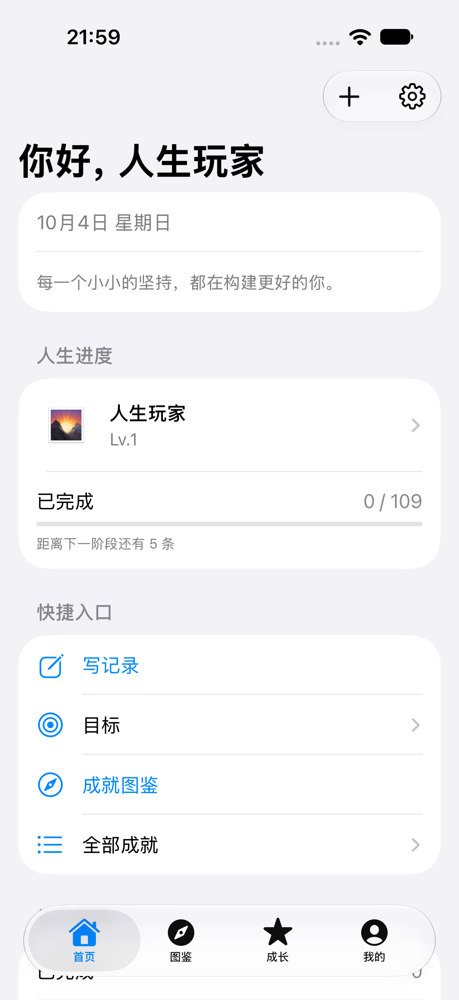
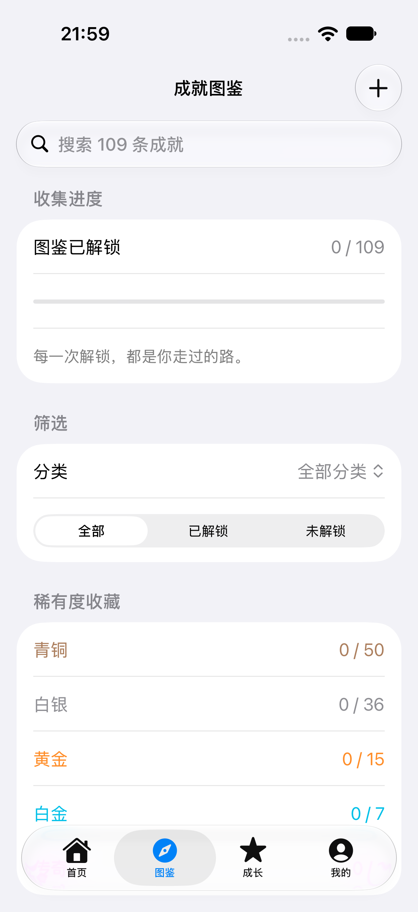
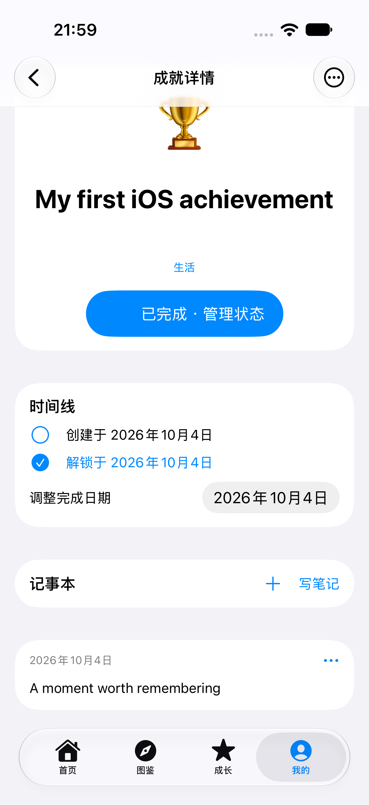

# LifeLedger-for-IOS

The native SwiftUI iPhone and iPad edition of [LifeLedger](https://github.com/mrlingan/LifeLedger). Collect life achievements, preserve memories, plan goals, and track growth. Records are stored on your device; the app requires no account or custom server and has no third-party SDK dependencies. Optional iCloud Drive backups use the system Files save dialog.

[简体中文](README.md) · [Contributing](CONTRIBUTING.md) · [Source notices](THIRD_PARTY_NOTICES.md)

## Run in Xcode

```bash
git clone https://github.com/mrlingan/LifeLedger-for-IOS.git
cd LifeLedger-for-IOS
open ios/LifeLedger.xcodeproj
```

1. Open `ios/LifeLedger.xcodeproj` in Xcode 26 or newer.
2. Select the shared **LifeLedger** scheme and an iPhone or iPad simulator.
3. Run with **⌘R**. The deployment target is **iOS 17**. No CocoaPods or Swift Package installation is required.
4. For a physical device, choose your own team under Signing & Capabilities and change the bundle identifier if needed. A developer account is not required for simulator builds.

Start with 109 preset achievements or an empty ledger. The complete codex is available either way.

## Features

- Native TabView navigation, lists, forms, section panels, buttons, pickers, and system dialogs. Appearance follows the installed iOS version.
- A customizable home page with profile, progress, statistics, categories, and recent achievements.
- Create, edit, search, complete, and delete achievements; adjust completion dates.
- A bilingual codex of 109 achievements across 14 categories, with five rarity tiers and unlock filters.
- Notes with original photos, videos, and Live Photo imports through the system photo picker.
- XP history, growth charts, long-term goals, daily tasks, and a reward store with refunds.
- Profile editing, light/dark themes, Chinese/English language settings, and optional background images.
- Optional local reminders, a six-digit app PIN, and biometric/device authentication.
- Optional AES-256-GCM encryption for structured local data. PIN verifiers and device keys are stored in Keychain.
- Full ZIP backups covering records, media, growth, goals, tasks, rewards, and settings, with optional passphrase encryption.
- Android ZIP and `LIFELED1` encrypted-backup import. Backups are validated before replacement; failed restoration preserves the current ledger.
- Manual **Back up to iCloud Drive** action. Saving and cancelling use the native Files interface.

The iOS app has no developer-options menu or demo-data generator.

## Screenshots

| Home | Codex | Achievement and note |
| --- | --- | --- |
|  |  |  |

## Back up to iCloud Drive

1. Sign in to your Apple Account and enable iCloud Drive in system Settings.
2. Open **Settings → Backup & restore** in LifeLedger and optionally enter a backup passphrase.
3. Choose **Back up to iCloud Drive**, return to Browse/Locations if the picker remembers a previous folder, select an iCloud Drive folder, and save.
4. On another device, choose the ZIP using **Choose backup file**, enter its passphrase if encrypted, verify it, and confirm restoration.

This is a manual file backup, not continuous synchronization. The system handles cloud uploads. Actual cloud upload requires a signed-in device and was not verified on the simulator. A private app iCloud container is not required.

## Data and compatibility

Records live in the app's private `Library/Application Support/LifeLedger/` directory. Media references are relative paths. A damaged ledger is preserved and exposes the backup recovery screen rather than being silently reset.

- Android → iOS migration is supported; the Android app does not currently import the full iOS backup format.
- Existing Android backups omit growth and reward-store records. Imported completed achievements rebuild XP at 50 XP per achievement.
- App PINs and device keys are excluded from backups. Device authentication and notifications must be re-enabled after restoring.
- Media uses iOS file protection without an additional AES content layer.
- ZIP processing uses memory and limits individual entries to 512 MiB and total content to 1 GiB; large videos can still exceed available device memory.
- Daily quotes are bundled text. Face ID, Live Photos from a real library, and notification delivery require further device validation.

## Validation

Validated with Xcode 27.0: Debug simulator build, unsigned Release compilation for an iOS device target, **13 unit tests and 3 UI tests passing**. UI tests cover native tabs, codex search, achievement completion, note creation, and the file exporter's save and cancel flows. Device-target compilation does not imply installation on a physical device. Distribution signing and App Store submission are not configured.

```bash
xcodebuild -project ios/LifeLedger.xcodeproj -scheme LifeLedger \
  -destination 'platform=iOS Simulator,name=iPhone 18 Pro' \
  -derivedDataPath ios/.build build

xcodebuild -project ios/LifeLedger.xcodeproj -scheme LifeLedger \
  -destination 'platform=iOS Simulator,name=iPhone 18 Pro' \
  -derivedDataPath ios/.build -parallel-testing-enabled NO test
```

Use an installed simulator name on your Mac. Keep simulator signing enabled because Keychain tests require it. UI tests use a separate `LifeLedger-UITests/` data directory.

## Contributing and license

Issues and pull requests are welcome. See [CONTRIBUTING.md](CONTRIBUTING.md) for the workflow and compatibility requirements.

[MIT License](LICENSE), © 2026 mrlingan. The original Android app, preset data, translations, and completion sound come from [LifeLedger](https://github.com/mrlingan/LifeLedger). The achievement catalog traces to [EarthOnline-Achievement](https://github.com/LKlingkong/EarthOnline-Achievement); see [THIRD_PARTY_NOTICES.md](THIRD_PARTY_NOTICES.md).
